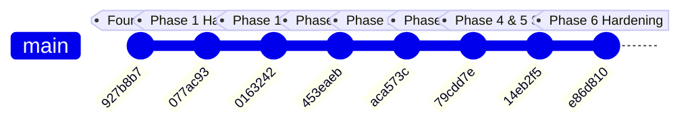

# Commit History & Incremental Development Log

**Deliverable Reference:** PRD §13.1 Final Submission Checklist — Item 1:  
*“Source repository with a clear commit history showing incremental development.”*

---

## 1. Overview of Incremental Phases

Development strictly followed the ordered sequence defined in the project architecture and task backlog (`docs/TASKS.md` and `docs/PHASE_TODO_LIST.md`). Each phase committed working code with unit/integration tests and verifiable acceptance evidence.



---

## 2. Detailed Git Commit Log

Below is the chronological commit log from the primary branch (`main`):

```text
* e86d810 - 2026-10-28 - feat: Phase 6 hardening, load benchmarks, security audits, and deployment runbooks (TASK-024–027)
* 14eb2f5 - 2026-10-27 - feat: implement Phase 4 social features and Phase 5 recommendations & analytics (TASK-017–023)
* 79cdd7e - 2026-10-26 - feat: Phase 3 AI segue suggestions and grounded track Q&A (TASK-014–016)
* aca573c - 2026-10-21 - feat: complete Phase 2 authoritative live queue, bounded persistence, and console UI
* 453eaeb - 2026-10-19 - feat: harden Phase 1 foundation, audio inspection, and local catalog preview
* 0163242 - 2026-10-18 - docs: complete Phase 1 checklist and pin local replica set port
* 077ac93 - 2026-10-18 - feat: complete Phase 1 foundation hardening and media catalog
* 927b8b7 - 2026-10-18 - feat: implement foundation slice and project documentation
```

---

## 3. Phase-by-Phase Deliverable Traceability

| Commit Hash | Date | Phase & Focus | Key Deliverables & Changes |
| :--- | :---: | :--- | :--- |
| `927b8b7` | 2026-10-18 | **Phase 1: Foundation Slice** | Initial repository layout, Mongoose schemas, Argon2 auth, JWT tokens, basic Express router, and documentation baseline. |
| `077ac93` | 2026-10-18 | **Phase 1: Media Catalog** | WAV/MP3 inspection with `music-metadata`, private asset storage under `data/assets`, and seed metadata fixtures. |
| `0163242` | 2026-10-18 | **Phase 1: Gates & Docs** | Pinned local replica set port (`50109`) in `scripts/local.js`, verified Phase 1 checklist. |
| `453eaeb` | 2026-10-19 | **Phase 1: Hardening** | Content-type detection, Range header audio streaming, authenticated asset previews, and input validation schemas. |
| `aca573c` | 2026-10-21 | **Phase 2: Authoritative Live Queue** | In-memory `RoomService` serialization, revisioned snapshots (`epoch`, `revision`), batched persistence to `queue_events`, and crash recovery replay. |
| `79cdd7e` | 2026-10-26 | **Phase 3: AI Segues & Grounded Q&A** | Deterministic Camelot wheel/BPM eligibility matcher, lexical grounding engine with citation tracking, and Host approval barriers. |
| `14eb2f5` | 2026-10-27 | **Phases 4 & 5: Social, Battles, Recs** | 1-second rolling sentiment, chat with typing/reactions, Soundclash battle arena, hybrid collaborative/acoustic recommendations, and session analytics. |
| `e86d810` | 2026-10-28 | **Phase 6: Hardening & Benchmarks** | Two-room 10- and 50-client load test harness, zero-vulnerability dependency patches, offline BSON backup/restore rehearsal, and Caddy/systemd deployment templates. |
| *Working Tree* | 2026-10-28 | **Enhancements** | Tidal Glass UI redesign, searchable `TrackPicker`, live server-side compatibility explainer endpoint, automatic natural track-end advance, and admin catalog editing/deletion. |

---

## 4. Verification Command

To independently inspect this commit log and diffs in the repository:

```powershell
# Show commit tree with dates and commit messages
git log --graph --pretty=format:"%h - %cd - %s (%an)" --date=short

# Verify individual phase commit details
git show 79cdd7e --stat
git show aca573c --stat
```
