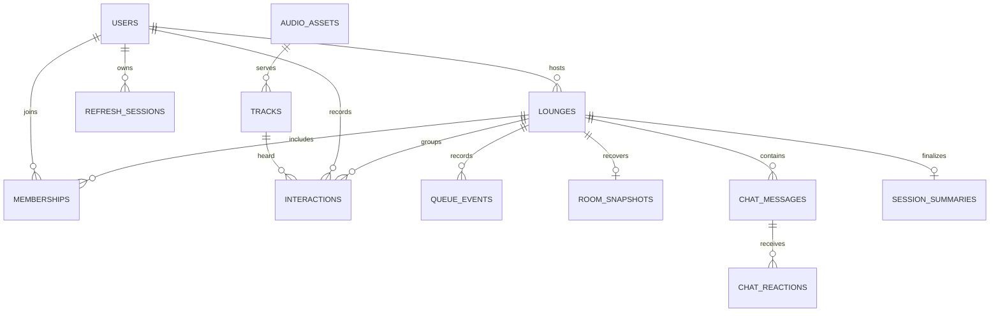

# Database schema

28 October 2026 IMP-002 uses existing tracks/audio_assets fields and profileVersion; no schema migration. Replacement keeps track ID and updates assetId/duration/profile with an incremented version. Deletion removes the track, then unreferenced media; historical room/event/interaction/summary records remain. MongoDB/filesystem cleanup is not atomic and may leave recoverable orphans. [Compatibility and recovery](CATALOG_MANAGEMENT.md).

28 October 2026 frontend redesign adds no schema, migration, seed or persistence changes. Mobile navigation and expanded diagnostics are client-local presentation state. [Scope](FRONTEND_REDESIGN.md).

Phase 6 adds no migration or collection changes. Offline backups preserve Extended JSON BSON types, collection validators/options, indexes including text weights, migration ledger and hashed referenced assets. Restore refuses nonempty targets; ordinary recovery creates a new epoch and pauses playback. [Backup and compatibility limits](PHASE_SIX_IMPLEMENTATION.md).

Migration 005-personal adds interactions (unique loungeId/userId/playbackId; userId/createdAt/ID history index), session_summaries (unique loungeId) and recommendation_jobs (private bounded artifact). Interactions store server-bounded playedSeconds, completion/like, profile snapshot, observedAt and revision. The summary stores canonical-log counts/timeline/history and final revision. [Compatibility and backup review](PHASE_FIVE_IMPLEMENTATION.md#migration-and-rollback).

Phase 4 storage update: migration `004-social` adds `chat_messages` with unique messageId and loungeId/revision paging index. Fields include server identity/displayName, body, msgType, createdAt, tsSeconds, revision, versioned sentiment score/bucket and reactions (four allowlisted emoji arrays of member IDs). This implemented embedded reaction projection replaces the planned separate chat_reactions collection below. Canonical chat/reaction/battle/sentiment events and snapshots share existing batch transactions; typing is never stored. Old snapshots default missing social fields. [Backup/rollback compatibility](PHASE_FOUR_IMPLEMENTATION.md#persistence-and-rollout).

Phase 3 adds additive reducer-v1 payloads `ai.segue`, `ai.decision`, `ai.question`; snapshots contain nullable `segueProposal`, five `recentTrackIds` and `questionCount`. Existing mixed state/payload validators require no new collection migration. Bounded actor-bound command receipts include answer/citation results but are excluded from public snapshots; question text is not stored. Source IDs encode track/profile/event versions and citation text is captured with the response. Old checkpoints load defaults, recovery clears actionable proposals. Old binaries cannot replay new events; rollback requires a pre-rollout backup or compatible reader. No migration/reset was run for this slice. See [Phase 3 implementation](PHASE_THREE_IMPLEMENTATION.md).

Phase 1 as built: immutable migrations 001/002 and a unique migration runner lock protect startup; database validators reject invalid profiles even through raw writes. Tracks may use `profileStatus: pending` with null `acoustic` for private imports, or `ready` with a valid profile. Administrator profile updates atomically set ready and increment `profileVersion`. Imported assets have `uploadedBy: null`, `importActor: local-operator`, SHA-256 provenance and detected MIME type. `command_receipts` has unique `(actorId, commandId)`, canonical request hash, lounge ID/creation time and 24-hour TTL; create receipts are committed with the lounge and host membership. Old migration files must not be reformatted or edited.

Selected implementation: MongoDB/Mongoose (PRD Option B). Migrations 001–003 implement foundation storage plus `queue_events` and `room_snapshots`; chat, interactions and analytics collections below remain planned. UUID strings identify application records and are serialized identically in JSON. References are logical foreign keys; services validate references and use transactions for coupled persistent changes. All times are UTC BSON dates; elapsed media time uses seconds; vote counts/revisions are integers.

As built: refresh family is one session document with current tokenHash, consumedHashes, absolute expiresAt and revokedAt. JWT `sid` references that family; replay/logout revoke it and its sockets. Public track creation requires an asset; metadata fixtures have no audio. Live room revision and durability are authoritative in the in-memory state, event log and recovery checkpoint; the legacy lounge revision is not the live queue watermark. Database validators and checksummed migration runner are implemented. See [Phase 2 field/retention notes](PHASE_TWO_IMPLEMENTATION.md).

Phase 2 checkpoint state uses `nextUp` (entries include sorted `voters` and a compact track/profile snapshot), `enqueueSequence`, `reservedEntryId`, `nowPlaying` (`playbackId`, `trackId`, `assetId`, `durationSeconds`, `offsetSeconds`, numeric monotonic-anchored `startedAt`, `paused`), members/settings, and the most recent 256 command receipts. Clients never receive receipt hashes. Each canonical reducer event has `eventSeq: 0` and optional `receipt`; projection/checkpoint writes share its transaction. Presence identities in historical state are discarded on recovery; socket IDs are never persisted. A new recovery epoch is checkpointed before accepting commands.

## Collections and fields

Unless marked optional, fields are required. All collections have `_id: UUID`, `createdAt: Date`, `schemaVersion: integer=1`; mutable collections also have `updatedAt`. Never expose password/token fields through response serialization.

| Collection | Fields and constraints | Indexes |
| --- | --- | --- |
| users | `emailNormalized:string`, `displayName:string(1..80)`, `passwordHash:string`, `isAdmin:boolean=false`, `disabledAt:Date?` | Unique emailNormalized |
| refresh_sessions | `userId→users`, `tokenHash:string`, `familyId:UUID`, `expiresAt:Date`, `revokedAt:Date?`, `replacedBy:UUID?` | Unique tokenHash; userId; TTL expiresAt (authorization still checks time) |
| tracks | `title:string(1..160)`, `artist:string(1..160)`, `durationSeconds:number>0`, `assetId→audio_assets`, `acoustic:{bpm:number>0,camelotKey:string,energy:number,valence:number}`, `profileVersion:int>0`, `timeline:[{id:UUID,ts:number,type:enum,text:string,sourceLabel:string}]`, `archivedAt:Date?` | acoustic.bpm + acoustic.camelotKey; archivedAt; title |
| audio_assets | `storageKey:string`, `mimeType:string`, `byteLength:int>0`, `sha256:string`, `licenseLabel:string`, `sourceAttribution:string`, `uploadedBy→users` | Unique storageKey; sha256 |
| lounges | `hostUserId→users`, `seedTrackId→tracks`, `vibeProfile:string`, `status:scheduled/live/ended`, `settings:{maxParticipants:int[2,50],bpmTolerancePct:number[0,8],soundclashEnabled:bool,aiVerbosity:brief/normal}`, `inviteHash:string`, `inviteExpiresAt:Date`, `locked:bool`, `startedAt:Date?`, `endedAt:Date?`, `summaryStatus:none/pending/complete` | Unique inviteHash; hostUserId+createdAt; status |
| memberships | `loungeId→lounges`, `userId→users`, `role:listener/co_dj/host`, `muted:bool`, `removed:bool`, `joinedAt:Date`, `leftAt:Date?` | Unique loungeId+userId; userId+joinedAt |
| room_snapshots | `loungeId→lounges`, `epoch:UUID`, `revision:int>=0`, `reducerVersion:int`, `state:object`, `persistedAt:Date` | Unique loungeId (latest recovery checkpoint only) |
| queue_events | `loungeId→lounges`, `epoch:UUID`, `revision:int`, `eventSeq:int>=0`, `commandId:UUID`, `actorId→users?`, `type:string`, `payload:object`, `reducerVersion:int`, `occurredAt:Date` | Unique loungeId+epoch+revision+eventSeq; loungeId+occurredAt; loungeId+commandId |
| chat_messages | `loungeId→lounges`, `messageId:UUID`, `userId→users?`, `msgType:chat/ai_answer/system/dj_announcement`, `body:string`, `sentimentScore:number?`, `sentimentBucket:positive/neutral/negative?`, `tsSeconds:number>=0`, `sourceEvents:[UUID]`, `eventId→queue_events` | Unique messageId; loungeId+createdAt+_id; unique eventId |
| chat_reactions | `loungeId→lounges`, `messageId→chat_messages.messageId`, `userId→users`, `emoji:allowlisted string` | Unique messageId+userId+emoji |
| interactions | `userId→users`, `trackId→tracks`, `loungeId→lounges`, `playbackId:UUID`, `playedSeconds:number>=0`, `completed:bool`, `liked:bool`, `startedAt:Date`, `endedAt:Date?`, `eventId→queue_events` | Unique userId+playbackId; userId+createdAt; trackId+createdAt |
| session_summaries | `loungeId→lounges`, `durationSeconds:number`, `peakParticipants:int`, `battleCount:int`, `questionCount:int`, `sentimentTimeline:[{at:Date,score:number,sampleSize:int}]`, `sourceWatermark:{epoch,revision}`, `algorithmVersion:int` | Unique loungeId |
| model_versions | `version:string`, `status:training/ready/failed/active`, `trainedThrough:Date`, `dataHash:string`, `config:object`, `metrics:object`, `artifactKey:string`, `failureReason:string?` | Unique version; status+createdAt |

Timeline IDs are unique within a track and immutable across edits; references always include trackId/profileVersion when interpreting historical citations. Camelot key regex: `^(?:[1-9]|1[0-2])[AB]$`. Energy and valence are finite in [0,1]. Timeline time is in [0,durationSeconds]; type is sample_credit/trivia/glossary. Proposal limits: timeline ≤100 entries, each text ≤2,000 characters, chat ≤1,000, question ≤500. Maintain validation in request schemas and Mongoose, with MongoDB JSON schema validators for critical types/ranges.

## Room snapshot payload and event model

Snapshot state includes ordered `queueEntries:[{entryId,trackId,addedByUserId,enqueueSequence,position,voters:[userId]}]`, `nowPlaying:{playbackId,trackId,startedAt,pausedOffsetSeconds}|null`, `battle:{id,status,candidates,votesByUser,closesAt,winnerCandidateId,applicationStatus}|null`, pending segue proposal, recent played IDs, and rolling sentiment inputs. Candidate contains candidateId/trackId/submitterId. Persist votes in batches through events and recovery snapshots; do not create per-vote synchronous database writes. Position is derived from array order, not a competing authority.

Ephemeral sockets, typing state and ping samples do not persist. Unique-user presence transitions are events so peak concurrency can be reconstructed. Accepted chat, vote change, battle lifecycle, playback, question, moderation, profile version reference and sentiment tick events drive all projections. Store canonical event inputs and rule versions for replay; do not rely on re-running an LLM during replay. Persist the generated result and citations.

Atomicity: one batch transaction inserts immutable events and updates chat/reaction/interaction projections plus recovery watermark. Snapshot updates are partial recovery checkpoints, not final analytics summaries. The latter are written only on end-session after all batches flush. Normal command acknowledgements can precede persistence; see REQ-018 and OQ-04.

## Relationships

The diagram represents logical references and ownership, not SQL FK enforcement. Queue entries, candidates and votes live inside bounded room state; their historical mutations remain in queue_events. Limit queue to a provisional 200 entries and chat history to cursor pages; do not embed unbounded chat/interactions in lounges. Bound session duration or archive events to avoid unbounded memory; keep only rolling sentiment/history windows in process.

## Relational comparison required by PRD §3

For Option A or C only, PostgreSQL would normalize users/refresh_sessions/tracks/audio_assets/lounges/memberships and the event/projection tables above. `track_timeline_events(id PK,track_id FK,profile_version,ts,type,text,source_label)` replaces embedded timeline; `queue_entries(id PK,lounge_id FK,track_id FK,position,enqueue_sequence,added_by FK)` and `queue_votes(entry_id FK,user_id FK, PK(entry_id,user_id))` replace queue arrays. Battles/candidates/battle_votes use analogous foreign keys and unique `(battle_id,user_id)`. A partial unique index on active battle per lounge enforces one battle. Unique `(lounge_id,position)` must be deferrable or positions swapped through temporary values in an atomic reorder. Sparse positions can reduce single-move writes, but full vote sorts may still rewrite several rows. Both models retain in-memory authority and batched event persistence; neither requires DB writes on each vote. PostgreSQL is not an additional deployed store.

## Migrations, data integrity and retention

Use ordered `server/migrations/NNNN-description.js` files with checksums and a migrations ledger, one migration runner at a time. Create validators/indexes before seed insertion. Seed idempotently using stable demo IDs; do not overwrite user edits. Bootstrap admin through an operator-only command, never public registration. A single-node MongoDB replica set enables transactions; a standalone server is insufficient ([MongoDB transactions](https://www.mongodb.com/docs/manual/core/transactions/)).

For changes: backup first, add optional fields/indexes, backfill in bounded batches, validate, switch reads, then remove obsolete fields in a later release. Take a pre-migration snapshot; restore to a new volume to test recovery. Prefer forward repair over destructive down migrations. Profile updates increment version and invalidate caches/proposals. Archive tracks referenced by history; prohibit deleting referenced audio without an explicit archival policy. Proposed 30-day demo retention must preserve linked events/projections together; do not TTL queue_events independently of summaries and evaluations. Export/anonymize user-linked test data and document backup retention before broader use.

28 October 2026 enhancement: Track-picker enhancement has no storage, index or migration changes; it displays existing catalog projections only. [Scope and limitations](TRACK_SELECTION_ENHANCEMENT.md).

28 October 2026 automatic continuation: Automatic continuation reuses playback.start events with internal null actor and fresh playback ID. No schema/index/migration change; restart remains paused. [Behavior and validation](AUTOMATIC_QUEUE_CONTINUATION.md).

28 October 2026 listening-flow enhancement: SessionSummary.summary adds optional resolvedBattleCount, last-100 battleOutcomes and battleOutcomesTruncated from canonical resolution events. Existing Mixed storage accepts these without migration/index changes; old summaries remain readable, with no backfill. [Contracts, limits and actual validation](LISTENING_FLOW_IMPROVEMENTS.md).

28 October 2026 acceptance work: the runtime Mongoose timeline now explicitly declares the embedded object schema already enforced by MongoDB validators. No collection shape, validator, migration or historical migration checksum changes; create/read/edit regression covers existing object compatibility. See [acceptance closure](ACCEPTANCE_CLOSURE.md).
