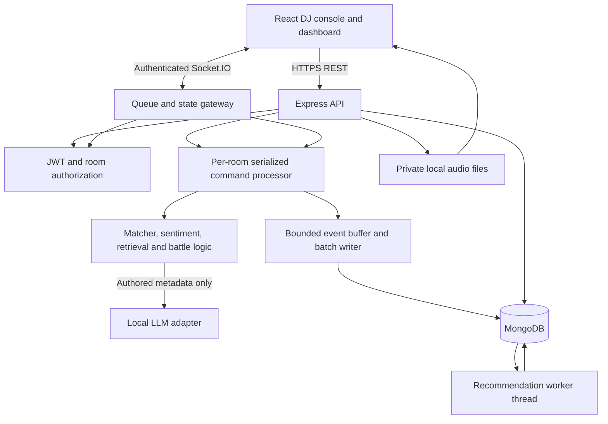
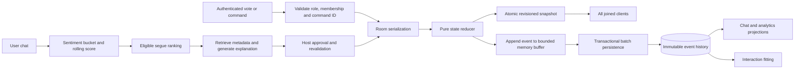

# Architecture

Phase 1 implementation note (19 October 2026): one process serializes lounge creation by actor and joins by room. Transactional creation receipts prevent duplicate lounges on network retries; they are not exactly-once delivery. A bounded per-IP handshake throttle precedes socket authentication. Private library import detects audio content and hashes files, leaving unverified acoustic data pending. Browser previews use authenticated asset fetches and do not advance the shared room clock. High-frequency queue/event authority remains Phase 2.

Recommended baseline: Track A, PRD Option B, one Node/Express/Socket.IO process, MongoDB through one pooled Mongoose client, React JavaScript client, local asset volume and optional local LLM runtime. Logical modules are isolated; deployable microservices are unnecessary for a single-operator prototype. Requirements: REQ-001–022.

Implementation status: Phase 2 adds the live queue reducer, bounded event writer, presence/moderation, recovery and local playback console. The implemented decisions and transport bounds are in [Phase 2 implementation](PHASE_TWO_IMPLEMENTATION.md). The diagrams below still include future AI, chat and analytics; the supplied interactive diagram is preserved. See [current limitations](IMPLEMENTATION_STATUS.md).

> [!TIP]
> An interactive, verified standalone architecture diagram generated with Archify is available at [architecture.html](architecture.html) (source: [architecture.json](architecture.json)). It features signal-flow animations, guided focus tours, and theme switching.

## Component boundaries

| Module / proposed directory | Responsibility | Invariants |
| --- | --- | --- |
| `client/src/features` | Auth, lounge console, catalog admin, dashboard | Render snapshots; never author authoritative order |
| `server/src/auth` | Password/JWT/refresh and authorization | Current membership checked on every command |
| `server/src/catalog` | Audio manifest, validated profile/timeline versions | No Spotify/import URL fetch; no unknown file paths |
| `server/src/rooms` | Lifecycle, members, queue, timer, votes, moderation | Room-keyed serialization, one writer |
| `server/src/realtime` | Handshake, join, snapshot, fan-out, liveness | Room isolation; revision/epoch protocol |
| `server/src/ai` | Deterministic matcher/ranker, sentiment, retrieval and bounded generation | Model cannot change queue or relax hard constraints |
| `server/src/persistence` | Event batches, projections, summary/recovery | Durable watermark exposed separately from live revision |
| `server/src/recommendations` | Offline fitted co-listening/content ranker | Versioned artifacts; asynchronous update |
| `server/src/observability` | Correlation logs, metrics and health | No credentials/chat text in routine logs |

## Data and control flow

## Queue and priority semantics (provisional)

Maintain `{epoch, revision, durableRevision, status, hostConnected, nowPlaying, nextUp, battle, sentiment}` per room. `status` is scheduled/live/ended; host connection and persistence health are orthogonal flags. Next Up is sorted by vote count descending, then enqueue sequence, then entry ID. A vote does not interrupt playback. Only the immediate-next reservation is altered by an approved segue or eligible battle winner. Precedence: hard eligibility first; resolved eligible battle reservation; approved manual promotion; then AI score (0.5/0.3/0.2). Ineligible entries remain queued and visibly deferred. For no eligible entry, pause at track end and request a compatible submission.

Start and track-end timers use server time and a monotonic clock for elapsed duration. Browser playback requires user interaction; show an unlock-audio button and display blocked playback. Server state timestamps drive the Now Playing position; local audio output may drift and is not covered by the queue sync KPI. A synthetic clock drives deterministic tests. No DSP or actual crossfade is implemented.

Every mutation goes through one per-room FIFO. Avoid awaiting LLM/network work in that critical section. Capture room revision/current track and profile versions, generate outside the lock, re-enter to validate applicability. Changed state invalidates a stale proposal. Host accepts only a proposal for the current track, current settings and eligible candidate. Host rejection leaves queue untouched. At end of track without approval, pause.

Battle has draft → open → awaiting_tie/resolved/cancelled states. Require 2–4 distinct tracks on open; freeze candidate set. Battles may be opened by the Host/Co-DJ via REST/socket, or triggered autonomously by the internal AI DJ service actor when enabled in lounge settings (`soundclashEnabled=true`) and $\ge 2$ candidate submissions are queued. Deadline closes voting using server time. A unique winner reserves immediate next if compatible; otherwise record `deferred` and leave it in Next Up. A tie remains pending until authorized resolution; zero votes is also a tie. Resolution is idempotent and announces once. A second battle cannot open until the previous active battle resolves/cancels.

## Reconnect, consistency and durability

Socket.IO orders delivered events but defaults to at-most-once arrival; it is not a persistent queue. Implement app-level command IDs, acknowledgements, snapshots and duplicate protection ([official delivery guarantees](https://socket.io/docs/v4/delivery-guarantees/)). One full room snapshot per published revision is adequate at 50 participants; optimize only after measurement. Clients replace state atomically, ignore old revisions, and request snapshot after any gap or changed epoch. Events for chat/etc. carry the same envelope; UI never applies an older room snapshot over a newer one.

Joining obtains a consistent snapshot under the room serializer and subscribes before releasing it. Socket catch-up buffers newer events until snapshot is installed. Count unique connected users, not tabs. Emit join only on 0→1 sockets and leave only on 1→0 after a proposed 10-second participant grace. Host mutation freeze begins on detected last-host-socket loss; do not wait the participant grace. Timers cannot advance queue during freeze; chat/history remains available. Reconnection clears freeze and resynchronizes deadlines; expired battle resolves once after unfreeze.

REQ-018 deliberately uses memory authority. Batch every 1 second or 50 events, whichever comes first. Transactionally insert unique events and update projections/watermark in a single-node replica set. Events carry reducer version, resulting state/replay inputs and server sequence. Retry batches by unique `(loungeId, epoch, revision, eventSeq)` without duplicating effects. On write failure, mark degraded, stop queue mutations and cap buffer; keep readiness false. No unlimited buffering. This is bounded-loss durability, not zero-loss acknowledgement.

On graceful shutdown stop new commands, flush, save recovery snapshot, close sockets, and exit. After crash replay from durable snapshot/events only, create a new epoch, pause playback, clear ephemeral presence, reconstruct timers/votes, and require Host resume. Lost unflushed revisions are disclosed on recovery. Full session analytics summary is written only after an end-session flush barrier; if flush fails keep `summaryStatus=pending` and allow retry.

## Background work and deployment

Sentiment ticks and battle deadlines use timers; CPU-heavy recommendation fitting uses a worker thread. Retrieval is a small in-process lexical index over authored metadata; no vector DB. Room event buffers and short-lived metadata cache are bounded. Versioned catalog updates invalidate cache and pending proposals. No Redis/change streams needed because every mutation already passes through the gateway. Multiple rooms share the process with isolated state and per-room queues.

Deploy one app instance and persistent MongoDB/asset volumes on a private host. Additional instances would need distributed ownership/fencing and shared fan-out; explicitly excluded from this implementation. Record active-room count, batch lag, buffer length, reconnects, event latency, generation latency/fallback, and authorization failures. `/health/live` measures process liveness; `/health/ready` requires DB access, writable asset volume and functioning writer. LLM failure degrades generation, not core availability. [Environment setup](ENVIRONMENT_SETUP.md) defines operational rollout and rollback.
